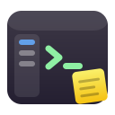
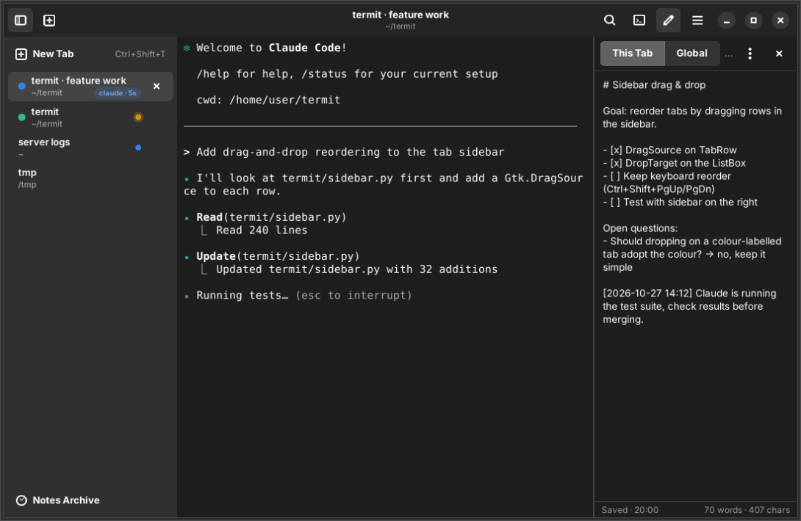
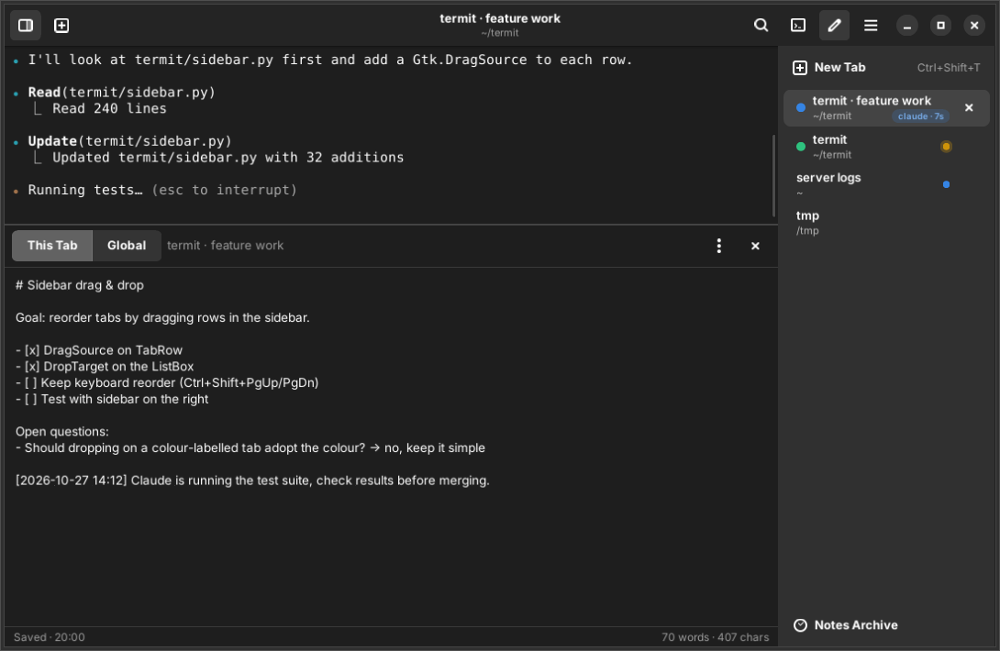

<p align="center">
  
</p>

<h1 align="center">Termit</h1>

<p align="center">
  A GNOME-style terminal with vertical tabs and a note attached to every tab.<br>
  Built with GTK 4, libadwaita and VTE for people who live in the terminal — and increasingly share it with AI coding agents such as Claude Code.
</p>

<p align="center">
  <a href="https://termit.aripd.com">Website</a> ·
  <a href="#installation">Installation</a> ·
  <a href="#features">Features</a> ·
  <a href="#keyboard-shortcuts">Shortcuts</a> ·
  <a href="CONTRIBUTING.md">Contributing</a>
</p>

<p align="center">
  
</p>

## Why Termit?

GNOME Terminal and Console are great, but when you keep ten shells open — a few of them running Claude Code — you quickly run out of horizontal tab space, lose track of which tab is doing what, and end up pasting reminders into random text files. Termit fixes exactly those pains:

- **Vertical tabs.** Tabs live in a sidebar on the left or right, with the folder, a colour label and the program currently running in each one.
- **Notes per tab.** Every tab has its own note. Notes are saved automatically, survive restarts, and are archived (not lost) when the tab closes.
- **Awareness.** The sidebar shows the running process and how long it has been running, highlights tabs with new output, and raises a desktop notification when a background tab rings the bell — for example when Claude Code waits for your input.

## Features

### Tabs
- Vertical tab sidebar, positioned left or right, collapsible with <kbd>Ctrl</kbd>+<kbd>Shift</kbd>+<kbd>B</kbd>.
- Each tab shows its title, working directory and the foreground process with an elapsed-time counter (for example `claude · 12m`).
- Colour labels (red, orange, yellow, green, blue, purple) to group tabs visually.
- Rename tabs (<kbd>F2</kbd>), reorder them with drag-and-drop or <kbd>Ctrl</kbd>+<kbd>Shift</kbd>+<kbd>Page Up/Down</kbd>, jump with <kbd>Alt</kbd>+<kbd>1</kbd>…<kbd>9</kbd>.
- Activity dot for tabs with new output; warning dot for tabs that rang the bell.
- Find a tab with <kbd>Ctrl</kbd>+<kbd>Shift</kbd>+<kbd>L</kbd>: the sidebar filters by title, folder, running process and even the text of the tab's note; <kbd>↑</kbd>/<kbd>↓</kbd> and <kbd>Enter</kbd> jump to it.
- New tabs open in the current tab's folder. Duplicate a tab with <kbd>Ctrl</kbd>+<kbd>Shift</kbd>+<kbd>D</kbd>.
- Confirmation before closing a tab (or the window) that still runs a program.
- Session restore: tabs, folders, titles, colours and notes come back on the next start.

### Notes
- A notes pane to the right of or below the terminal (<kbd>Ctrl</kbd>+<kbd>Shift</kbd>+<kbd>N</kbd>), with a "This Tab" note and a "Global" scratchpad.
- Autosave; <kbd>Esc</kbd> returns the focus to the terminal, <kbd>Ctrl</kbd>+<kbd>Shift</kbd>+<kbd>E</kbd> focuses the editor.
- When a tab closes, its note is kept in the **Notes Archive** (configurable: keep, delete or ask). Archived notes can be reopened in a new tab in the same folder, copied, or deleted.
- When you open a tab in a folder that has an archived note, a banner offers to restore it.
- Insert timestamps, copy or export a note as Markdown.

### Terminal
- Real terminal emulation through VTE — the same library GNOME Terminal uses.
- Light and dark mode following the system preference, or forced in Preferences. Seven colour palettes (GNOME, Tango, Dracula, Nord, Gruvbox, Catppuccin Mocha, Solarized).
- <kbd>Ctrl</kbd>+click opens URLs, e-mail addresses and file paths (`src/app.py:42` style paths are resolved relative to the shell's folder). OSC 8 hyperlinks are supported.
- Search with regular expressions and case sensitivity (<kbd>Ctrl</kbd>+<kbd>Shift</kbd>+<kbd>F</kbd>).
- Multi-line paste protection — skipped automatically while a program such as Claude Code is in the foreground, so pasting long prompts stays frictionless.
- Snippets menu (<kbd>Ctrl</kbd>+<kbd>Shift</kbd>+<kbd>S</kbd>) for commands you type all day; ships with `claude`, `claude --continue`, `claude --resume` and a few git commands. Edit them in Preferences.
- Zoom, scrollback, cursor shape, copy-on-select, login shell or custom command, and the usual GNOME Terminal options.
- Command line: `termit --working-directory DIR`, `termit --new-tab`, `termit -- htop`.

### Working with Claude Code
- Tell Claude Code to ring the terminal bell when it needs you:
  `claude config set --global preferredNotifChannel terminal_bell`. Termit turns the bell into a sidebar indicator and a desktop notification when the tab is in the background.
- Each tab exports `TERMIT_SESSION_ID`, so scripts and hooks can tell tabs apart.
- Keep the plan, open questions and follow-ups for each session in the tab's note; it stays with the tab, is archived when the tab closes and comes back when you reopen the folder.

## Installation

Termit is a Python application and needs GTK 4, libadwaita 1.4+ and VTE 0.72+ (GTK 4 build) with GObject introspection data.

**Debian / Ubuntu**

```sh
sudo apt install python3-gi gir1.2-gtk-4.0 gir1.2-adw-1 gir1.2-vte-3.91
```

**Fedora**

```sh
sudo dnf install python3-gobject gtk4 libadwaita vte291-gtk4
```

**Arch Linux**

```sh
sudo pacman -S python-gobject gtk4 libadwaita vte4
```

Then clone and install for your user:

```sh
git clone https://github.com/aripdcom/termit.git
cd termit
make install          # installs to ~/.local
```

Or run it straight from the checkout:

```sh
python3 -m termit     # or ./bin/termit
```

For a system-wide install use `sudo make install PREFIX=/usr/local`; `make uninstall` removes everything again.

<p align="center">
  
  <br><em>Sidebar on the right, notes below the terminal — both are a preference away.</em>
</p>

## Keyboard shortcuts

| Shortcut | Action |
| --- | --- |
| <kbd>Ctrl</kbd>+<kbd>Shift</kbd>+<kbd>T</kbd> / <kbd>W</kbd> | New tab / close tab |
| <kbd>Ctrl</kbd>+<kbd>Shift</kbd>+<kbd>D</kbd> | Duplicate tab in the same folder |
| <kbd>Ctrl</kbd>+<kbd>Page Up</kbd> / <kbd>Page Down</kbd> | Previous / next tab |
| <kbd>Ctrl</kbd>+<kbd>Shift</kbd>+<kbd>Page Up</kbd> / <kbd>Page Down</kbd> | Move tab up / down |
| <kbd>Alt</kbd>+<kbd>1</kbd> … <kbd>9</kbd> | Switch to tab 1–9 |
| <kbd>F2</kbd> | Rename tab |
| <kbd>Ctrl</kbd>+<kbd>Shift</kbd>+<kbd>L</kbd> | Find a tab (filters the sidebar) |
| <kbd>Ctrl</kbd>+<kbd>Shift</kbd>+<kbd>B</kbd> | Show or hide the tab sidebar |
| <kbd>Ctrl</kbd>+<kbd>Shift</kbd>+<kbd>N</kbd> | Show or hide notes |
| <kbd>Ctrl</kbd>+<kbd>Shift</kbd>+<kbd>E</kbd> | Focus the note editor (<kbd>Esc</kbd> goes back) |
| <kbd>Ctrl</kbd>+<kbd>Shift</kbd>+<kbd>S</kbd> | Snippets |
| <kbd>Ctrl</kbd>+<kbd>Shift</kbd>+<kbd>C</kbd> / <kbd>V</kbd> | Copy / paste |
| <kbd>Ctrl</kbd>+<kbd>Shift</kbd>+<kbd>F</kbd> | Find (<kbd>Ctrl</kbd>+<kbd>Shift</kbd>+<kbd>G</kbd> / <kbd>H</kbd> next / previous) |
| <kbd>Ctrl</kbd>+<kbd>Shift</kbd>+<kbd>K</kbd> | Clear scrollback |
| <kbd>Ctrl</kbd>+<kbd>+</kbd> / <kbd>-</kbd> / <kbd>0</kbd> | Zoom in / out / reset |
| <kbd>Ctrl</kbd>+<kbd>Shift</kbd>+<kbd>P</kbd> | Preferences |
| <kbd>Ctrl</kbd>+<kbd>?</kbd> | Keyboard shortcuts |
| <kbd>F11</kbd> | Fullscreen |
| <kbd>Ctrl</kbd>+<kbd>Shift</kbd>+<kbd>Q</kbd> | Quit |

## Where Termit stores things

| Path | Content |
| --- | --- |
| `~/.config/termit/config.json` | Preferences and snippets |
| `~/.local/share/termit/notes/<id>.md` | One Markdown file per tab note |
| `~/.local/share/termit/notes/index.json` | Note titles, folders and archive state |
| `~/.local/share/termit/global-notes.md` | The global scratchpad |
| `~/.local/share/termit/session.json` | Open tabs for session restore |

Notes are plain Markdown, so you can grep, back up or version them like any other files.

## Language

The interface is in English and switches to Turkish automatically when the system locale is Turkish. Translations live in `termit/translations_tr.py`; contributions for other languages are welcome.

## Roadmap ideas

- Split panes inside a tab
- Tab groups / workspaces in the sidebar
- Broadcasting input to several tabs
- Flatpak packaging

## Contributing

Bug reports, feature requests and pull requests are welcome. See [CONTRIBUTING.md](CONTRIBUTING.md) for how to set up a development environment and the project conventions.

## License

Termit is released under the [MIT License](LICENSE).
